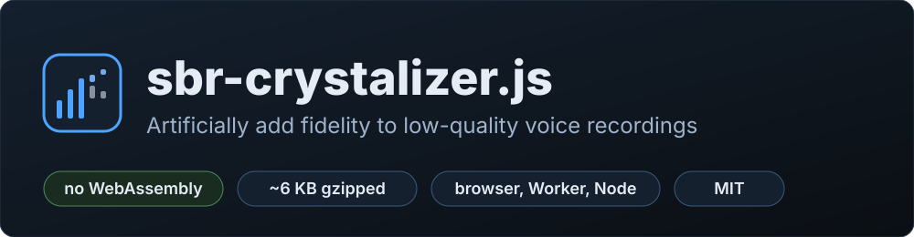
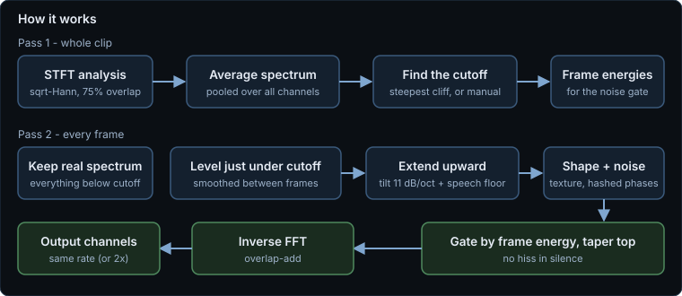
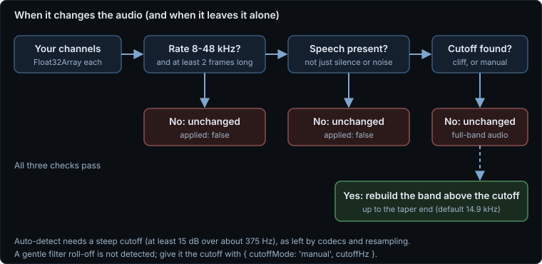
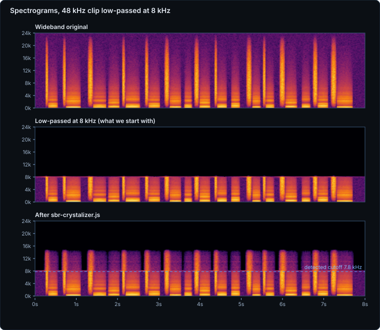
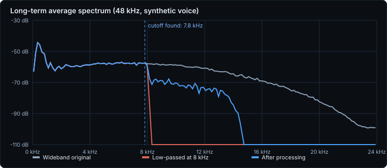
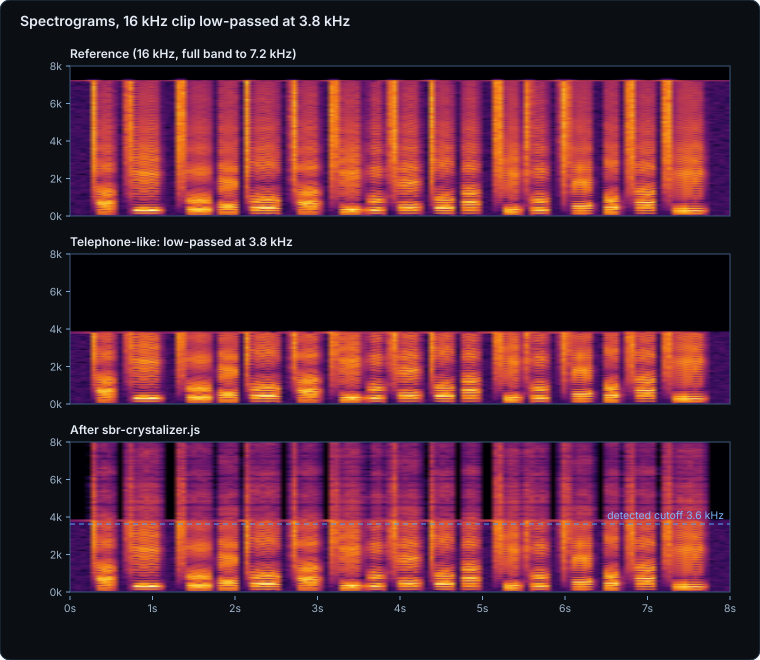

<p align="center"></p>

<p align="center">
  <a href="LICENSE"></a>
  
  
  
  <a href="https://dialersapps.pages.dev/lab/notes/sbr-crystalizer.html"></a>
</p>

**sbr-crystalizer.js** artificially adds fidelity to low-quality voice recordings. Phone-line, VoIP, low-bitrate-codec
and old-resampler speech all share one fault: everything above some cutoff frequency is simply missing, so the voice
sounds dull and muffled. This library finds that cutoff, then **synthesises a speech-shaped top end above it** (spectral
band replication, the same idea HE-AAC uses, applied to a finished recording). Plain JavaScript, no WebAssembly, no
dependencies, no DOM: it runs in a page, in a Web Worker, in an Android WebView or in Node.

> [!IMPORTANT]
> This is a **perceptual enhancer, not a reconstruction**. It adds *plausible* high-frequency content; it cannot recover
> information a recording has lost, and it will not make a bad recording match a good one. It is built for **speech**.
> See [Known limits](#known-limits) and [What we did and did not measure](#numbers-what-we-measured).

**Contents:** [Why](#why) · [Quick start](#use) · [API](#api) · [How it works](#how-it-works) · [Numbers](#numbers-what-we-measured) · [Tests](#tests) · [Limits](#known-limits) · [Licence](#licence)

## Why

Voice recorded through a narrow channel loses its top end. Speech is not short of it: the 4 to 12 kHz region carries
the sibilance of *s* and *sh*, breath, the "air" around a voice and much of what makes a talker sound present and
close. A codec that cuts at 8 kHz, or audio that was once sampled at 16 kHz and upsampled, leaves a flat hole above
the cutoff, and the ear reads that as muffled.

Bandwidth extension is a well-known fix in codecs, but we could not find a small, dependency-free, MIT-licensed
JavaScript implementation you can point at a finished recording. We needed one for voice in a web and Android app
that handles many different recordings, so we wrote it, and we are releasing it for anyone to use.

| | sbr-crystalizer.js |
|---|---|
| Ships as | one .js file (6.3 KB gzipped) plus an identical ES module |
| Loading | plain script, ES module or `require()`; nothing to fetch |
| Input | one or more `Float32Array` channels, sample rate 8 to 48 kHz |
| Speed (our PC) | about 0.27 s for 10 s of mono at 48 kHz, about 0.09 s at 16 kHz |
| Deterministic | yes: the same clip always renders to the same samples |

## Use

```html
<script src="sbr-crystalizer.js"></script>
<script>
  // channels: an array of Float32Array, e.g. from AudioBuffer.getChannelData(); sampleRate in Hz
  const result = await sbrCrystalizer.process(channels, sampleRate);
  if (result.applied) play(result.channels, result.sampleRate);   // else: nothing to fix, you got your input back
</script>
```

ES module (`sbr-crystalizer.mjs`, same code):

```js
import sbrCrystalizer from "./sbr-crystalizer.mjs";   // or: import { process } from "./sbr-crystalizer.mjs";
```

Node / CommonJS: `const sbrCrystalizer = require("./sbr-crystalizer.js");`

Try it without writing any code: serve this folder with any static server and open [`demo.html`](demo.html), then pick a
recording of your own. Nothing is uploaded; it all runs locally.

## API

`sbrCrystalizer.process(channels, sampleRate, options?, hooks?)` returns a Promise of
`{ applied, channels, sampleRate, info }`.

- `channels`: array of equal-length `Float32Array`s (your arrays are never modified).
- `sampleRate`: 8000 to 48000. Anything else is handed back untouched.
- When `applied` is `false`, `channels` are your input arrays and `info.reason` says why:
  `nocliff` (no steep cutoff found), `nospeech`, `short`, `rate`, `empty`, or `zero` (strength 0).
- When `applied` is `true`, `channels` are new arrays and `info` holds `cutoffHz`, `cliffFound`, `cliffDropDb`,
  `frameSize` and the settings used.
- `hooks.yieldFn`: async function called every few dozen frames (default `setTimeout 0`) so a long clip does not freeze a page.
- `hooks.signal`: any object with an `aborted` property (an `AbortSignal` works). If it turns `true` the promise rejects with an `AbortError`.

Other exports: `sbrCrystalizer.version`, `.defaults`, `.limits` (`[min, max, step]` for each numeric option, handy for sliders)
and `.normalizeOptions(raw)`.

### Options

| Option | Default | What it does |
|---|---|---|
| `cutoffMode` | `"auto"` | `"auto"` detects a steep cutoff; `"manual"` uses `cutoffHz` |
| `cutoffHz` | 4000 | Cutoff for manual mode (3000 to 16000) |
| `cliffDb` | 15 | How steep (dB drop over about 375 Hz) a roll-off must be to count as a cutoff in auto mode (6 to 30) |
| `strength` | 0.85 | Level of the new band; 1 means the level just under the cutoff (0 to 1.5) |
| `tilt` | 11 | How fast the new band falls with frequency, dB per octave (3 to 24) |
| `floor`, `floorSlope` | 0.5, 9 | A long-term speech-spectrum floor that keeps the top present when a codec left it hollow, and its slope above 2 kHz |
| `taperEndHz` | 14900 | Nothing is generated above this; the top 14% rolls off smoothly |
| `texture` | 1 | 0 gives a flat noise band; 1 shapes it by the harmonic texture just below the cutoff |
| `gateEnabled`, `gateThreshold` | true, 6 | Opens the new band only on frames louder than the clip's quiet floor, so silence and room noise do not turn into hiss |
| `doubleRate` | false | Output at twice the sample rate for input of 24 kHz or less, so a 16 kHz clip can carry content up to 14.9 kHz |

## How it works

**Pass one** reads the whole clip: a short-time Fourier transform (sqrt-Hann windows, 75% overlap), an average spectrum
pooled over all channels, a per-frame energy track, and the cutoff - the steepest cliff in the average spectrum, or
a frequency you give it. **Pass two** goes frame by frame: everything at or below the cutoff is copied through
**unchanged**; above it, the library measures the level just under the cutoff, extends it upward with a speech-like
downward tilt and a speech-spectrum floor, shapes it with the texture of the band just below the cutoff, gives it
**deterministic pseudo-random phases** (noise, which is what fricatives and breath are), gates it by frame energy and tapers
the top, then inverse-transforms and overlap-adds.

<p align="center"></p>

It is deliberately conservative about when to act. If the audio is already full-band, is mostly silence or noise, is too short, has
a sample rate outside 8 to 48 kHz, or has no steep cutoff, you get your input back untouched:

<p align="center"></p>

## Numbers (what we measured)

**Everything below was measured on a synthetic, seeded voice-like signal** (vowel-like formants plus fricative-like noise;
see [`tools/measure.mjs`](tools/measure.mjs)), run in Node 24 on one Windows PC. It is reproducible with
`npm run measure`. **We have not run a listening test and have not measured a corpus of real speech**, so treat these as a check
that the algorithm does what it claims, not as proof it sounds better on your recordings. Judge by ear with [`demo.html`](demo.html).

A wideband original was low-passed with an ideal cutoff at 8 kHz (the way a codec or resampler cuts), then processed:

<p align="center"></p>

<p align="center"></p>

The same test at 16 kHz sampling, with the original cut at 3.8 kHz (a narrow-band, phone-like clip):

<p align="center"></p>

| Case | Detected cutoff | Result |
|---|---|---|
| 48 kHz, ideal cut at 8 kHz | 7.8 kHz (true 8.0) | The 9 to 14 kHz band is rebuilt to about -71 dB, against -58 dB in the original and -157 dB left by the cut. Log-spectral distance to the original in that band: 91.5 dB before, 12.1 dB after |
| 16 kHz, ideal cut at 3.8 kHz | 3.6 kHz (true 3.8) | The 4.3 to 7 kHz band is rebuilt to about -78 dB, against -60 dB original and -172 dB cut. Distance 101.0 dB before, 15.1 dB after |
| 48 kHz, gentle 8th-order roll-off at 8 kHz | **not detected** in auto mode | With the cutoff given manually: distance 36.2 dB before, 13.1 dB after |
| Full-band speech-like signal | none | Returned untouched (same array) |
| Noise only | none | Returned untouched |

- **The rebuilt band is quieter than the original** (about 13 dB lower in the 48 kHz case) on purpose: it is a plausible fill, not a copy, and it
  is tapered so it does not hiss. Log-spectral distance measures how close the spectral envelope is, not how it sounds.
- **Everything below the cutoff is unchanged**: mean absolute difference below the cutoff was 0.0002 dB (48 kHz) and 0.0013 dB (16 kHz).
- **Deterministic**: processing the same clip twice gives identical samples, and identical left and right channels stay identical.
- **Speed**: 10 s of mono at 48 kHz took about 267 ms; 10 s at 16 kHz about 85 ms.
- **Size of the code**: `sbr-crystalizer.js` is about 16 KB with the licence header and comments, about 11 KB with comments and whitespace stripped
  (a crude strip, not a real minifier), and 6.3 KB gzipped as shipped (about 4.1 KB stripped and gzipped).

## Tests

Serve this folder with any static server and open [`test.html`](test.html), or run `npm test` (Node 18 or later). Both run the same 23 checks on
seeded synthetic signals: cutoff detection, band gain above the cutoff, a transparent region below it, input arrays left unmodified, determinism, stereo
behaviour, pass-through for full-band noise, silence, short clips, out-of-range sample rates and empty input, manual cutoff,
`doubleRate`, `yieldFn` and `AbortSignal`. `test.html` also checks the ES module build against the script build. All passed at the time of writing in
Node 24 and Chromium.

## Known limits

- **Speech only.** It assumes voice. We have not tested it on music and do not recommend it there: the new band is a speech-shaped noise fill, which will not sound right on instruments.
- **Needs a steep cutoff in auto mode** (at least 15 dB over about 375 Hz, the kind codecs and resamplers leave). A gentle roll-off is not detected; use `{ cutoffMode: "manual", cutoffHz }` or lower `cliffDb`.
- **Does not restore, it invents.** What it adds is plausible, not the true original content, and it cannot undo noise, distortion or clipping.
- **One cutoff per clip.** It does not track a cutoff that moves during a recording, and it does not denoise or equalise anything below the cutoff.
- **8 to 48 kHz input**, at least a couple of analysis frames long. The whole clip is processed in memory.
- **Measured only on synthetic voice,** with no listening test or real-speech corpus (see above), and tested in Node and Chromium only.
- "SBR" is also the name of the bandwidth-extension tool in HE-AAC. This library is **not** an HE-AAC or MPEG implementation, shares no code with any codec and is not compatible with a bitstream; we have not done a patent search.

## Where the code comes from

sbr-crystalizer.js was written by Dialer's Apps from general signal-processing knowledge (the short-time Fourier transform with overlap-add,
spectral-envelope extension, spectral tilt and gating) and contains no code copied from another project. We use the term "spectral band replication" for
the general idea of rebuilding a missing high band from the band below it.

## Licence

MIT, see [`LICENSE`](LICENSE). Copyright (c) 2026 Dialer's Apps.

Made by [Dialer's Apps](https://dialersapps.pages.dev/). Read the story behind it in the
[blog post](https://dialersapps.pages.dev/lab/notes/sbr-crystalizer.html).